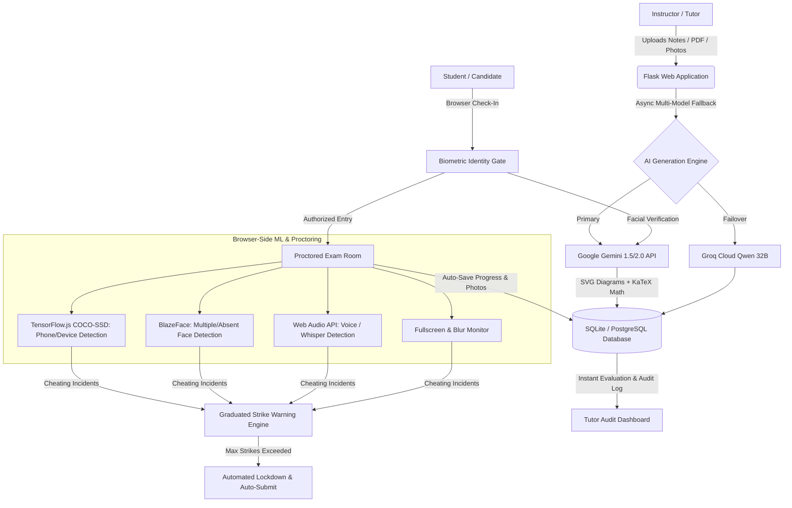

# 🛡️ ExamGuard AI: Executive Portfolio & Engineering Case Study

**Project Name:** ExamGuard AI — Smart Online Examination System with Multi-Sensor Anti-Cheating & AI Question Generation  
**Engineering Domain:** B.Tech Major Project / EdTech & Cybersecurity / Computer Vision & Applied Generative AI  
**Author / Developer:** Prashanta Kumar Das  
**Live Application:** [https://online-examination-system-with-anti.onrender.com/](https://online-examination-system-with-anti.onrender.com/)  
**Source Code Repository:** [GitHub Repository](https://github.com/pinku-21/Online-Examination-System-with-Anti-Cheating-Detection)

---

## Executive Summary

Remote examination systems frequently struggle with two severe bottlenecks: **time-intensive question authoring** and **vulnerable academic integrity**. Traditional online test platforms rely on honor codes or costly third-party human proctoring services that fail to scale.

**ExamGuard AI** is a production-grade, full-stack proctored examination platform designed to solve both challenges end-to-end:
1. **Generative AI Question Studio**: Converts raw syllabus PDFs, textbook images, and prompts into rigorous questions (MCQs, True/False, and Subjective) complete with SVG geometric vector diagrams, rubric grading keys, and KaTeX math notation.
2. **Client-Side AI Multi-Sensor Proctoring**: Runs on-device machine learning in real time inside the student's browser via TensorFlow.js (COCO-SSD device detection and BlazeFace facial tracking) paired with Web Audio API acoustic analysis.
3. **High-Precision Biometric Identity Gate**: Authenticates candidate face biometrics with Gemini Vision AI against registered reference photos with strict impersonation rejection.
4. **Resilient Exam Lifecycle Engine**: Features auto-saving every 30 seconds, multi-page handwritten proof uploads with intelligent blur suppression, scheduled exam windows, tutor-approved pause/resume states, and a graduated strike termination policy.

---

## Architecture & System Design

---

## Key Engineering Innovations & Feature Matrix

| Feature Module | Technology Stack | Practical Real-World Impact |
| :--- | :--- | :--- |
| **Multimodal Exam Studio** | Google Gemini Vision, Groq API, PyMuPDF, SVG | Generates complete 80-mark, 50-mark, or custom exam papers in seconds, auto-rendering mathematical symbols (KaTeX) and vector diagrams. |
| **Biometric Face Verification** | Gemini Vision AI & Fallback Structural Analyzer | Prevents proxy attendance and student impersonation before admitting students to the exam. |
| **Device & Phone Detection** | TensorFlow.js, COCO-SSD | Flags smartphones, tablets, or unauthorized electronic gadgets held in the camera field of view in real time. |
| **Candidate Presence Monitoring** | BlazeFace / FaceMesh | Detects when a student walks away (>3 seconds) or if unauthorized helpers enter the camera frame. |
| **Whisper & Voice Detection** | Web Audio API (RMS energy analysis) | Flags unauthorized room communication or reading questions aloud to accomplices. |
| **Browser Lockdown** | Fullscreen API, Page Visibility API | Disables tab switching, window blurring, copy-paste, DevTools inspection, and context menus. |
| **10-Second Strike Return Penalty** | Reactive Client Timers & Webhooks | Enforces immediate return to the exam window upon a warning modal, adding penalty strikes if ignored. |
| **Handwritten Photo Uploads** | Multi-file Canvas, Mobile Camera Capture | Students can upload multi-page handwritten proofs without triggering false window blur strikes. |
| **Audit Logs & Analytics** | Flask, Jinja2, UTC to IST Time Localization | Complete timestamped chronological trail of every student action and warning strike for institution review. |
| **Cryptographic Integrity (HMAC-SHA256)** | Python `hashlib` & `hmac`, Non-repudiation | Generates immutable verification tokens over score and submissions, preventing backend and transit data tampering. |
| **Virtual Camera Anti-Spoofing** | WebRTC `enumerateDevices()` driver heuristics | Stops OBS Virtual Cam, ManyCam, and pre-recorded looping video bypasses of webcam proctoring. |
| **SIEM Security Operations Center (SOC)** | Standardized `SEC-001..013` taxonomy & Client IP | Categorizes anti-cheat violations into high/critical cyber incident alerts with origin telemetry. |

---

## Technical Challenges & Solutions

### 1. Eliminating False Positives During Handwritten Photo Uploads
* **Challenge:** On mobile phones and tablets, clicking "Take Photo" launches the native camera app, firing browser `blur` and `fullscreenchange` events that previously triggered cheating strikes.
* **Solution:** Engineered a dedicated file-browsing suppression latch (`isBrowsingFile`) with an event cooldown timer (12-second grace buffer) that silences window blur monitoring while students snap and upload homework proofs, then cleanly prompts re-entry to full-screen.

### 2. Sub-Second Real-Time Proctoring Without Server Load
* **Challenge:** Streaming continuous webcam video frames from hundreds of students simultaneously to a backend server causes bandwidth exhaustion and excessive latency.
* **Solution:** Decentralized ML inference to client edge devices via TensorFlow.js and Web Audio API. Video and audio frames are analyzed locally in the student's browser at 15–30 FPS; only verified violation events are posted to the backend API.

### 3. Preventing AI Impersonator False Matches
* **Challenge:** Lenient facial matching algorithms could produce false 90%+ match rates between different individuals with similar skin tone or background lighting.
* **Solution:** Implemented high-precision geometric landmark constraints in Gemini Vision AI prompts and an offline structural correlation fallback (0.70 structural weight, 0.72 pass threshold), preventing friends or family members from taking exams on a registered student's behalf.

### 4. Mathematical Formula Rendering
* **Challenge:** AI generators often returned raw unparsed LaTeX (`\sqrt{4}`, `\frac{22}{7}`), which confused students and broke radio button string concatenation when backslashes were unescaped.
* **Solution:** Embedded KaTeX mathematical rendering with auto-render scripts across student and tutor portals, paired with direct DOM event bindings for choices to ensure all math notation renders crisply and accurately.

### 5. Virtual Camera Stream Spoofing & Cryptographic Submission Non-Repudiation
* **Challenge:** Tech-savvy candidates attempted to loop pre-recorded webcam footage through virtual webcam drivers (OBS Virtual Cam, ManyCam) to bypass computer vision, while potential database tampering could falsify scores.
* **Solution:** Integrated hardware driver heuristics via `navigator.mediaDevices.enumerateDevices()` to reject known virtual video device drivers, client-side DevTools debugger latency traps, and computed server-side HMAC-SHA256 digital certificates over final scores, timestamps, and strikes, mathematically guaranteeing immutability.

---

## Live Verification & Access Credentials

- **Live Production URL:** [https://online-examination-system-with-anti.onrender.com/](https://online-examination-system-with-anti.onrender.com/)
- **Teacher / Admin Portal:** `/login?role=admin`
- **Student Exam Portal:** `/login?role=student`
- **Demo Exam Access Code:** `QRRZMX`

---

## Skills & Competencies Demonstrated

- **Languages & Frameworks:** Python 3.13, Flask, JavaScript (ES6+), HTML5, Tailwind CSS
- **Machine Learning & AI:** Google Gemini Multimodal API, Groq Cloud API, TensorFlow.js, COCO-SSD, BlazeFace, Computer Vision, Edge AI
- **Database & Architecture:** SQLite / PostgreSQL (Neon/Supabase ready), Connection Pooling, Transactional Integrity
- **Cybersecurity & Proctoring:** Fullscreen Enforcement, Web Audio Energy Detection, Anti-Tamper Event Listeners, Session Hardening
- **DevOps & Deployment:** Render Cloud, Gunicorn, Git Version Control, Environment Configuration Management
