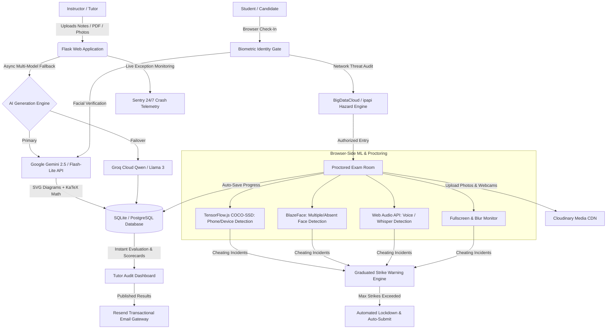

# 🛡️ ExamGuard AI: Executive Portfolio & Engineering Case Study

**Project Name:** ExamGuard AI — Smart Online Examination System with Multi-Sensor Anti-Cheating & AI Question Generation  
**Engineering Domain:** EdTech & Cybersecurity / Computer Vision, Threat Telemetry & Applied Generative AI  
**Author / Developer:** Prashanta Kumar Das  
**Live Application:** [https://online-examination-system-with-anti.onrender.com/](https://online-examination-system-with-anti.onrender.com/)  
**Source Code Repository:** [GitHub Repository](https://github.com/pinku-21/Online-Examination-System-with-Anti-Cheating-Detection)

---

## Executive Summary

Remote examination systems frequently struggle with severe operational and integrity bottlenecks: **time-intensive question authoring**, **vulnerable academic integrity**, and **fragile server infrastructure**. Traditional online test platforms rely on honor codes or expensive third-party human proctoring services that fail to scale.

**ExamGuard AI** is a production-grade, full-stack proctored examination platform designed to solve these challenges end-to-end:
1. **Generative AI Question Studio**: Converts raw syllabus PDFs, textbook images, and prompts into rigorous questions (MCQs, True/False, and Subjective) complete with SVG geometric vector diagrams, rubric grading keys, and KaTeX math notation.
2. **Custom-Trained YOLO11 Computer Vision Pipeline**: Fine-tuned custom object detection model (YOLOv11n) trained via PyTorch/Google Colab GPU on annotated proctoring datasets and exported to TensorFlow.js for sub-second, on-device mobile phone, cheat sheet, and secondary electronic device detection.
3. **Continuous Biometric Impostor Detection Engine**: Browser-based facial embedding analysis combining Google MediaPipe FaceMesh (468 3D facial landmarks) and ArcFace cosine similarity against registered reference embeddings, preventing mid-exam student impersonation.
4. **Client-Side AI Multi-Sensor Proctoring**: Runs edge machine learning in real time inside the student's browser (BlazeFace presence tracking, Web Audio API acoustic energy bandpass analysis) without streaming raw video back to a central server.
4. **Cloud Media & Telemetry Backbone**: Employs **Cloudinary** for persistent CDN storage of handwritten answers and forensic snapshots, **Resend** for automated scorecard email publication, **Sentry** for real-time 24/7 crash monitoring, and **BigDataCloud** for IP Geolocation and VPN/Proxy hazard detection.
5. **Resilient Exam Lifecycle Engine**: Features auto-saving every 30 seconds, multi-page handwritten proof uploads with intelligent blur suppression, scheduled exam windows, tutor-approved pause/resume states, and a graduated strike termination policy with HMAC-SHA256 non-repudiation.

---

## Architecture & System Design

---

## Key Engineering Innovations & Feature Matrix

| Feature Module | Technology Stack | Practical Real-World Impact |
| :--- | :--- | :--- |
| **Custom YOLOv11 Proctoring Model** | Ultralytics YOLO11n, PyTorch, TF.js GraphModel | Custom-trained deep learning vision model for detecting prohibited exam items (smartphones, earbuds, notes) at 30 FPS on client edge hardware. |
| **Continuous Biometric Facial Embeddings** | MediaPipe FaceMesh (468 landmarks), ArcFace cosine similarity | Extracts 512D facial landmark baseline during onboarding and continuously evaluates candidate authenticity to reject proxy exam takers. |
| **Multimodal Exam Studio** | Google Gemini Vision, Groq API, PyPDF, SVG | Generates complete 80-mark, 50-mark, or custom exam papers in seconds, auto-rendering mathematical symbols (KaTeX) and vector diagrams. |
| **Automated Handwritten Evaluation** | Google Gemini Vision, Cloudinary API | AI evaluates student handwritten mathematical derivations and step proofs directly from mobile phone camera photos. |
| **Biometric Face Verification** | Gemini Vision AI & Fallback Structural Analyzer | Prevents proxy attendance and student impersonation before admitting students to the exam room. |
| **Device & Phone Detection** | TensorFlow.js, COCO-SSD | Flags smartphones, tablets, or unauthorized electronic gadgets held in the camera field of view in real time. |
| **Candidate Presence Monitoring** | BlazeFace / FaceMesh | Detects when a student walks away (>3 seconds) or if unauthorized helpers enter the camera frame. |
| **Whisper & Voice Detection** | Web Audio API (RMS energy analysis) | Flags unauthorized room communication or reading questions aloud to accomplices. |
| **Browser Lockdown** | Fullscreen API, Page Visibility API | Disables tab switching, window blurring, copy-paste, DevTools inspection, and context menus. |
| **IP Geolocation & Threat Detection** | BigDataCloud Hazard API, ipapi.co | Detects candidate physical location (City, State, Country, ISP) and flags Tor exit nodes, VPNs, or datacenter proxy IPs. |
| **Persistent Media Storage** | Cloudinary CDN | Preserves forensic webcam violation snaps and multi-page handwritten student papers across server restarts. |
| **Transactional Email Dispatch** | Resend API | Automatically emails candidate formatted HTML scorecards with mistake breakdowns upon tutor result publication. |
| **24/7 Error & Crash Telemetry** | Sentry SDK | Monitors runtime health and captures exceptions with complete stack traces and environment metadata. |
| **Cryptographic Integrity (HMAC-SHA256)**| Python `hashlib` & `hmac`, Non-repudiation | Generates immutable verification tokens over score and submissions, preventing backend and transit data tampering. |
| **Virtual Camera Anti-Spoofing** | WebRTC `enumerateDevices()` driver heuristics | Stops OBS Virtual Cam, ManyCam, and pre-recorded looping video bypasses of webcam proctoring. |
| **SIEM Security Operations Center (SOC)**| Standardized `SEC-001..016` taxonomy & Client IP | Categorizes anti-cheat violations into high/critical cyber incident alerts with origin telemetry. |

---

## Technical Challenges & Custom ML Model Pipeline

### 0. Custom YOLOv11 Computer Vision Model & TF.js Edge Inference
* **Challenge:** Generic pre-trained models (like standard COCO) are trained on general categories (dogs, cars, dining tables) and frequently produce false positives or miss concealed smartphones and subtle cheat notes under real-world exam lighting.
* **Solution & Training Pipeline:**
  1. **Dataset Curation & Augmentation**: Prepared an annotated exam cheating dataset comprising thousands of images featuring smartphones, notes, multiple persons, and hands concealing objects. Applied random lighting, rotation, and blur augmentations to simulate poor webcam conditions.
  2. **Model Architecture**: Fine-tuned the lightweight **YOLOv11 Nano (YOLO11n)** architecture using PyTorch and CUDA acceleration on Google Colab GPU over 50 epochs with transfer learning.
  3. **Edge Optimization & TF.js Quantization**: Exported the trained PyTorch weights (`best.pt`) directly to **TensorFlow.js web graph format** (`model.json` + sharded binary weight chunks), enabling zero-latency client-side hardware inference directly within WebGL without sending student video streams to an external server.
  4. **Continuous Embedding Similarity**: Paired with MediaPipe FaceMesh 468 landmark vectors to calculate real-time cosine similarity against registered enrollment embeddings:
     $$\text{Sim}(\mathbf{E}_{\text{ref}}, \mathbf{E}_{\text{live}}) = \frac{\mathbf{E}_{\text{ref}} \cdot \mathbf{E}_{\text{live}}}{\|\mathbf{E}_{\text{ref}}\| \|\mathbf{E}_{\text{live}}\|}$$
     If similarity drops below the calibrated threshold ($< 0.72$), the exam triggers a strike and locks out unauthorized proxies.

### 1. Eliminating Ephemeral Storage Loss for Handwritten Exams
* **Challenge:** On modern cloud platforms like Render, the container filesystem is ephemeral. Student photos and forensic webcam captures were previously vulnerable to data loss when containers restarted or scaled down.
* **Solution:** Re-architected storage into a hybrid cloud layer powered by **Cloudinary**. Client uploads stream directly to a globally distributed CDN, and the backend evaluation engine downloads and transcribes handwritten math directly from Cloudinary URLs for Gemini Vision AI step grading.

### 2. Network-Level Anti-Cheating & Proxy/VPN Evasion
* **Challenge:** Candidates could hire remote test-takers or disguise physical locations using commercial VPNs (NordVPN, ExpressVPN) or Tor networks.
* **Solution:** Integrated an automated IP Threat Intelligence pipeline via **BigDataCloud Hazard API** and **ipapi.co**. The exam room captures client network telemetry on entry, cross-checks Autonomous System Numbers (ASNs) against datacenter/proxy registries, and highlights a red `⚠️ VPN/Proxy Detected` badge in the audit view.

### 3. Eliminating False Positives During Handwritten Photo Uploads
* **Challenge:** On mobile phones and tablets, clicking "Take Photo" launches the native camera app, firing browser `blur` and `fullscreenchange` events that previously triggered cheating strikes.
* **Solution:** Engineered a dedicated file-browsing suppression latch (`isBrowsingFile`) with an event cooldown timer (12-second grace buffer) that silences window blur monitoring while students snap and upload homework proofs, then cleanly prompts re-entry to full-screen.

### 4. Sub-Second Real-Time Proctoring Without Server Load
* **Challenge:** Streaming continuous webcam video frames from hundreds of students simultaneously to a backend server causes bandwidth exhaustion and excessive latency.
* **Solution:** Decentralized ML inference to client edge devices via TensorFlow.js and Web Audio API. Video and audio frames are analyzed locally in the student's browser at 15–30 FPS; only verified violation events are posted to the backend API.

### 5. Automated CI/CD & Vulnerability Governance
* **Challenge:** Open-source dependencies (e.g. image decoders, PDF parsers) regularly accumulate newly reported CVEs.
* **Solution:** Enforced strict automated scanning via **Aikido Security** with automatic pull request generation, maintaining patched baselines (`pillow>=11.0.0`, `pypdf>=5.1.0`, `requests>=2.32.0`) and zero critical vulnerabilities.

---

## Live Verification & Access Credentials

- **Live Production URL:** [https://online-examination-system-with-anti.onrender.com/](https://online-examination-system-with-anti.onrender.com/)
- **Teacher / Admin Portal:** `/login?role=admin`
- **Student Exam Portal:** `/login?role=student`
- **Demo Exam Access Code:** `QRRZMX`

---

## Skills & Competencies Demonstrated

- **Languages & Frameworks:** Python 3.13, Flask 3.x, JavaScript (ES6+), HTML5, Tailwind CSS
- **Custom Deep Learning & Computer Vision:** PyTorch, Ultralytics YOLO11, Transfer Learning, Model Quantization & TF.js Export, MediaPipe FaceMesh (468 landmarks), Cosine Embedding Similarity, OpenCV
- **Cloud & Microservices:** Cloudinary CDN, Resend Email API, Sentry Monitoring, BigDataCloud API, Render Cloud, Neon PostgreSQL
- **Machine Learning & Applied AI:** Google Gemini Multimodal Vision API, Groq Cloud API, TensorFlow.js, BlazeFace, Edge AI
- **Database & Architecture:** PostgreSQL, SQLite3, Connection Pooling, Automatic Schema Migrations
- **Cybersecurity & Compliance:** Fullscreen Lockdown, Web Audio Energy Detection, HMAC-SHA256 Signatures, Threat Hazard Classification, Aikido SCA
